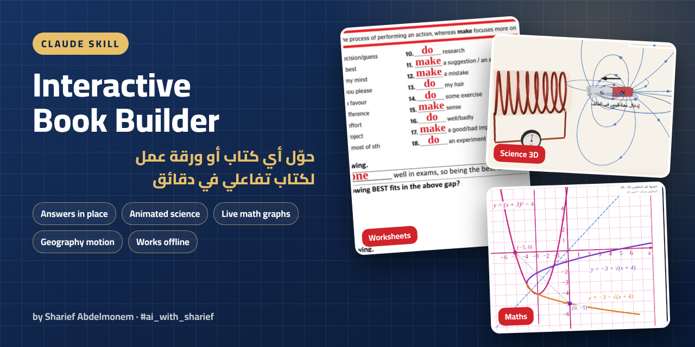

<p align="center"></p>

# Interactive Book Builder · مُحوِّل الكتب التفاعلية

<div dir="rtl">

**سكيل لـ Claude بتحوّل أي كتاب مدرسي أو ورقة عمل لكتاب تفاعلي**: PDF أو صور، صفحة واحدة أو كتاب كامل.

- **أوراق العمل:** الإجابات بتتكتب بالأحمر بخط اليد في مكانها بالظبط، مع زرار لكل سؤال، ولكل صفحة، وللكتاب كله، ومفتاح إجابات للمعلم.
- **العلوم:** التجارب بتتحول لنماذج متحركة الطالب يتحكم فيها، ومعاها «اختبرني».
- **الجغرافيا:** الخرائط والتضاريس بتبقى موشن جرافيكس.
- **الرياضيات:** الرسوم البيانية بتترسم من جديد وتتحرك بمنزلقات.
- تقليب صفحات حقيقي، وتكبير بصباعين، وغلاف، ونسخة **أوفلاين** في ملف واحد.

</div>


A Claude skill that turns school books and worksheets (PDF or page photos, one page or a whole book) into interactive flipbooks:

- **Worksheets** → answers handwritten in red exactly on the blanks, per-question / per-page / all-answers toggles, teacher answer key.
- **Science** → experiments become animated, controllable models (sliders, step-by-step, “Test me” quiz).
- **Geography** → maps and landforms become motion graphics.
- **Maths** → graphs redrawn live in place, with parameter sliders and transformations.
- Page-flip, two-finger pinch zoom, cover page, and a single **offline HTML** file.

## Structure
```
SKILL.md                         instructions Claude follows
scripts/extract.py               PDF → page images + text/blank coordinates
scripts/image_to_page.py         phone photo → flattened, cleaned page
scripts/imgtools.py              underline/grid detection + OCR helpers
scripts/blocks.py                question-block detection
scripts/zones.py                 answer-zone helpers (mcq, fill, rewrite…)
scripts/build_offline.py         inline images + fonts into one offline file
templates/answers-flipbook.html  worksheet flipbook ({{TITLE}}, {{NPAGES}}, {{TOC}}, /*DATA*/)
templates/science-3d-flipbook.html  physics example with three.js models
templates/math-graphs-page.html  live graph page example
templates/cover.html             cover design (Cairo, {{LOGO_DATA_URI}})
examples/grade10_answers.py      full answer spec, Grade 10 English worksheets
examples/grade11_answers.py      full answer spec, Grade 11 English worksheets
```

## Install
Upload `SKILL.md` as a skill in Claude, or add this folder to your skills directory. Then send any PDF or page photo and say: «حوّله لكتاب تفاعلي».

Built by Sharief Abdelmonem — #ai_with_sharief
